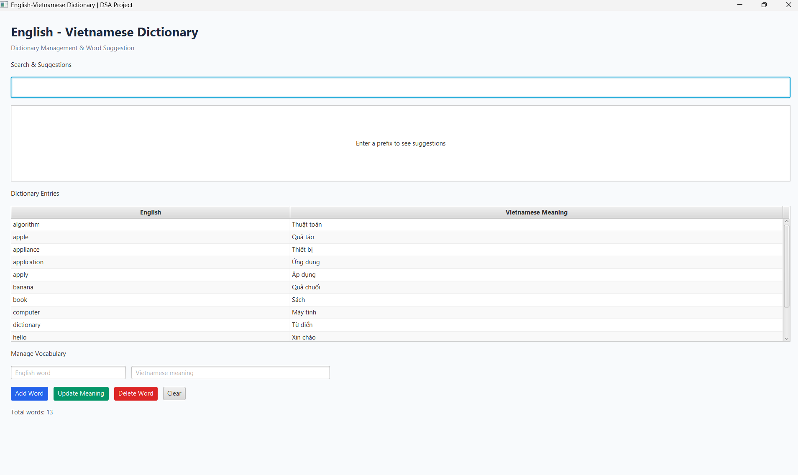
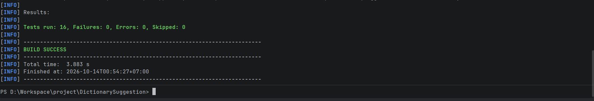

# English–Vietnamese Dictionary & Word Suggestion

A desktop dictionary management application developed using **Java 21, JavaFX, Trie, and HashMap**.

This project was developed as a midterm assignment for the **DSA Advanced Java** course.

## 1. Project Overview

The application allows users to manage English–Vietnamese vocabulary and receive word suggestions based on a search prefix.

The project demonstrates the practical application of two data structures:

- **Trie:** Efficient prefix searching and word suggestions.
- **HashMap:** Fast exact-word lookup and vocabulary management.

## 2. Main Features

- Add new English–Vietnamese vocabulary.
- Search for an English word.
- Suggest words based on an entered prefix.
- Update Vietnamese meanings.
- Delete existing words.
- Display vocabulary in a JavaFX TableView.
- Save and load dictionary data using CSV files.

## 3. Technologies

| Technology | Purpose |
|---|---|
| Java 21 | Programming language |
| JavaFX 21 | Desktop user interface |
| Maven | Build and dependency management |
| Trie | Prefix search and suggestions |
| HashMap | Exact word lookup |
| CSV | Persistent data storage |
| JUnit 5 | Automated testing |
| PlantUML | UML diagrams |

## 4. System Architecture

The project is organized into the following packages:

- `algorithm`: Trie and TrieNode implementations.
- `model`: Word data model.
- `repository`: CSV file operations.
- `service`: Dictionary business logic using Trie and HashMap.
- `controller`: JavaFX event handling.
- `DictionaryApp`: Main JavaFX application.

## 5. Requirements

- JDK 21
- Windows, macOS, or Linux with a supported JavaFX environment
- IntelliJ IDEA (recommended)
- Internet connection for the first Maven dependency download

## 6. How to Run

Clone the repository:

```bash
git clone https://github.com/YOUR_USERNAME/DictionarySuggestion.git
cd DictionarySuggestion
```

On Windows PowerShell, compile the project:

```powershell
.\mvnw.cmd clean compile
```

Run the JavaFX application:

```powershell
.\mvnw.cmd javafx:run
```

On macOS or Linux, use `./mvnw` instead of `.\mvnw.cmd`.

## 7. Automated Testing

Run all JUnit tests:

```powershell
.\mvnw.cmd clean test
```

Verified test results:

| Test Class | Passed |
|---|---|
| TrieTest | 6 |
| DictionaryServiceTest | 7 |
| DictionaryRepositoryTest | 3 |
| **Total** | **16** |

All 16 automated tests passed with zero failures, errors, or skipped tests.

## 8. UML Diagrams

The system's UML diagrams are stored in `docs/uml/`.

They describe the application's requirements, class relationships, interactions, and processing flow.

## 9. Screenshots

Application interface:



JUnit test results:



## 10. Future Improvements

- Import larger vocabulary datasets.
- Add fuzzy search for misspelled words.
- Support word pronunciation.
- Improve the JavaFX interface.
- Add more automated tests and performance benchmarks.

## 11. Academic Information

Course: DSA Advanced Java  
Project: English–Vietnamese Dictionary & Word Suggestion  
Assignment: Midterm Project  
Developer: Leo Nguyen
